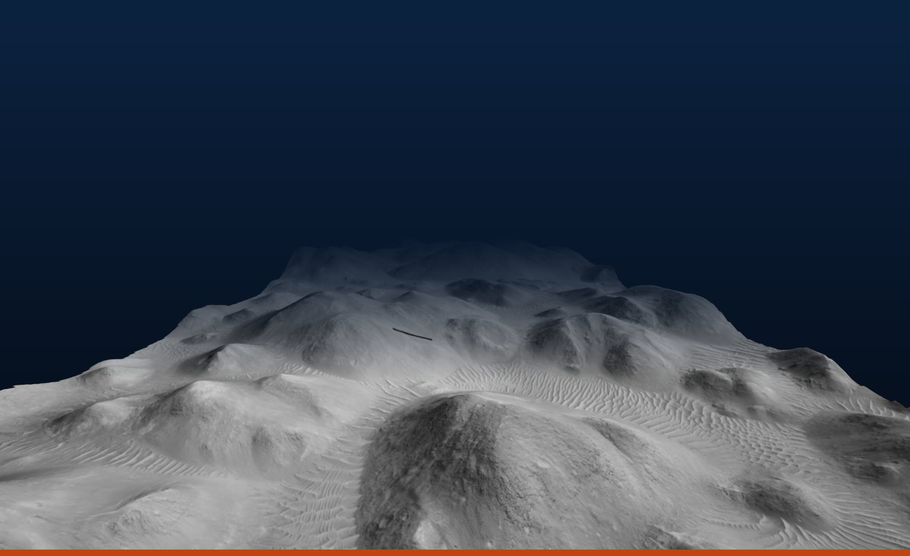

# HiRISE in VR

**Author: Raymundo "R@y" Olguin**, HiRISE VR Development Lead, HiRISE Operations Center (HiROC) and Space Imagery Center (SIC), a NASA Regional Planetary Image Facility, Lunar and Planetary Laboratory, University of Arizona.



An interactive website for viewing HiRISE terrain meshes and orthoimages in virtual reality. The HiRISE 3D Topographic Reconstruction Pipeline (obj_pipeline v6.3.9) turns a HiRISE stereo Digital Terrain Model (DTM) into a true-scale, textured 3D terrain mesh; Twinmotion 2025.2 and a Meta Quest over Meta Horizon Link then take that mesh and its orthoimage to a walkable scene inside a VR headset.

Every statement on the site is taken from four source documents by the author, all included in this repository:

| Source | File |
|---|---|
| Twinmotion VR User Manual v1.0 (October 2026) | `docs/manuals/Twinmotion_VR_User_Manual.pdf` |
| HiRISE Pipeline User Manual v6.3.9 | `docs/manuals/HiRISE_Pipeline_User_Manual.pdf` (and `.docx`) |
| HiRISE Pipeline Anatomy (interactive) | `docs/interactive/HiRISE_Pipeline_Anatomy.html` |
| HiRISE Ortho Selection (interactive) | `docs/interactive/HiRISE_Ortho_Selection.html` |

The 3D terrain on the site comes from two of the author's DTMs: `DTEEC_084570_1445_066516_1445_A01` (Gully Monitoring, from ESP_084570_1445 and ESP_066516_1445) in the opening flight and the Unlit demo, and `DTEEC_074396_1425_074251_1425_A01` (Gorgonum Chaos, from ESP_074396_1425 and ESP_074251_1425) in the closing flight.

## What is on the site

**`index.html`, the guide.** Two scroll-driven flights over real HiRISE terrain, with four interactive chapters between them.

| Section | Content | Source |
|---|---|---|
| Opening flight | Scroll-driven descent over the Gully Monitoring DTM, unlit, vertical exaggeration 1.0 | DTM data |
| From orbit to your headset | Key numbers of the DTM, then one orbitable 3D view in four steps: Elevation (colour = height), Mesh (wireframe, downsampling factor 1 / 2 / 4 / 8), Photograph (Default lighting, doubled shading), Unlit (the faithful view); vertical exaggeration 1.0 / 3.0; Play button | Pipeline manual Ch. 1 and 5; Pipeline Anatomy; Twinmotion manual 5.2 |
| Choosing the photograph | Line-of-sight diagram with a camera-angle slider, E = √(g² + (Δz·tan e)²), and the two real images of the stereo pair with their native pixel footprints | Ortho Selection page; RDR labels |
| One folder, three files | Folder-name decoder with a Mars longitude/latitude grid, and an OBJ / MTL / JPG chain you can break (rename, move) to see the flat-white result | Twinmotion manual 2; Pipeline manual 6 and 10 |
| Into the headset | 12-step screenshot walkthrough and the six navigation speeds | Twinmotion manual 3 to 7 |
| Closing flight | Scroll-driven flyover of Gorgonum Chaos (DTEEC_074396_1425_074251_1425_A01) to the rim of a fresh crater | DTM data and RDR labels |

**`science.html`, the pipeline reference**

| Section | Content | Source |
|---|---|---|
| Ortho selection | Score E = √(g² + (Δz·tan e)²) calculator with the real emission angles and binning of ESP_066516_1445 and ESP_084570_1445 | Ortho Selection page |
| Triangle budget | T_full = 2(H − 1)(W − 1), s = ⌈√(T_full / B)⌉, B = 10,000,000, preset to the full DTM size (7291 × 5172 posts) | Pipeline Anatomy, Mesh math |
| Outputs | Folder layout, coordinate conventions, opening meshes in other software | Pipeline User Manual, Ch. 6 |
| RUN.bat, screen by screen | 12 screenshots of a 15-project run, wizard answers for common jobs | Pipeline User Manual, Ch. 4, 5 and App. A |
| The front end, in detail | SETUP.bat, data preparation, the five questions, menus, console, roles, and a RUN.bat step-through with the Gully Monitoring DTM | Pipeline User Manual, Ch. 4 and 5 |
| Twinmotion VR, in detail | Site folder files, requirements, import settings, material values, controller and gamepad controls, performance steps | Twinmotion manual 1 to 8 |
| Troubleshooting | Searchable table, pipeline and Twinmotion rows | Pipeline manual Ch. 10; Twinmotion manual 9 |
| References | Scientific papers cited in the source documents | Pipeline manual App. A.3; Ortho Selection page |

The search dialog (Ctrl K / ⌘ K) jumps to any section, document or troubleshooting row.

## Run the pipeline: RUN.bat simulation (home page, `#runbat`)

An interactive simulation of the pipeline front end (`assets/js/wizard.js`). It follows the Pipeline User Manual (v6.3.9), Chapters 4 and 5:

- the five RUN.bat questions (project path, DTM downsampling, OBJ precision, output mode, reports and data tables);
- the two Standard-mode menus (mesh format, texture encoding);
- the RUNNING PIPELINE summary;
- the console blocks from PROJECT DISCOVERY to PIPELINE COMPLETE.

It runs on the Gully Monitoring DTM, and a panel beside the console explains each parameter. The same simulation is also in the pipeline reference (`science.html#frontend`). On phones the console is shortened so the question and its answers fit on one screen.

## Interludes: flights between the chapters (`assets/js/interludes.js`)

Between the chapters of the home page are four scroll-driven flights, each over a different DTM produced at HiROC by Raymundo "R@y" Olguin. None of them repeats the opening (Gully Monitoring) or closing (Gorgonum Chaos) flights.

| Between | DTM | Camera move |
|---|---|---|
| Process and Choosing the orthoimage | Gullies Tempe Terra, DTEEC_018518_2295_018795_2295_A01 | `rim`: orbit around the centre of the window, descending toward the rim |
| Choosing the orthoimage and Inside a site folder | Cavil Angusti South Polar, DTEPC_013720_1035_013707_1035_A01 | `spiral`: 270° spiral from an oblique overview down to the lowest point |
| Inside a site folder and Into the headset | North Polar Layered Deposits Bench, DTEPD_010109_2655_009991_2655_A01 | `valley`: low pass across the window, 90 to 150 m above the highest ground ahead |
| Into the headset and Explore all 40 DTMs | Guilled Crater, DTEED_012904_1360_012759_1360_A01 | `crane`: starts on the floor facing the highest relief, then rises to an overview |

How the flights work:

- **Paths:** each path is fitted to the terrain, using the lowest point in the central 44 % of the window, the highest point in the central 60 %, and the window centre. The camera is kept at least 30 m above the ground.
- **Look:** true scale (vertical exaggeration 1.0) and unlit. Fog and a rounded-square alpha fade dissolve the window edges into the background.
- **Caption:** shows the region, coordinates, DTM product ID, relief and the live height above the ground, with links to open the site in the explorer and to the next chapter.
- **Memory on iPhone:** all four flights share one WebGL renderer, and its canvas moves to the flight on screen, so only that flight's terrain is on the GPU. If iOS drops the context anyway, it is rebuilt when the browser restores it. If WebGL is unavailable, the flight shows a still of its orthoimage.
- **Adding or swapping a flight:** use a `<section class="ilude" data-dtm="<slug>" data-move="rim|spiral|valley|crane">` block with any slug from `assets/data/dtms/catalog.json`.

## iPhone cover animation (hero, portrait phones)

While the title is on screen on a phone in portrait (aspect ratio below 0.9), the cover uses three effects:

- **Turntable orbit:** the camera circles the Gully Monitoring crater once every 46 s, with a slow ±0.06 rad tilt. This is `idle.spin` and `idle.breathe` in `framing.js`.
- **Rising contour, then auto-triangulation:** each 11 s cycle starts with a warm elevation contour sweeping from the crater floor to the rim. Then the mesh triangulates itself: starting at the crater centre, blue edges spread outward, splitting every quad of four posts into two triangles as the pipeline does (drawn at a display spacing of 34 cells across the window). The orthoimage then returns. Faint iso-elevation lines sit underneath it, at an interval of relief / 14 rounded to 5 m.
- **Soft edges:** a radial fade dissolves the square DTM window into the background.

The two terrain effects run in a TSL node material (`three/tsl`, `MeshBasicNodeMaterial`), driven by the uniforms `uLevel` (contour elevation) and `uFx`. `uFx` follows the intro fade, so all three effects ease out as you scroll, and the descent and eye-level ending are unchanged.

Desktop, tablets and landscape phones keep the original sway. `prefers-reduced-motion` turns all three effects off.

## Inside a site folder (home page, `#files`)

An interactive tree of the real folder the pipeline writes for one site (`<id>` = DTM product ID):

```
<id>/
  <id>.IMG                      DTM, PDS format
  ESP_*_RED_C_01_ORTHO.JP2/.LBL orthoimages and labels
  JP2_CONVERTED/                ORTHO_SELECTION.csv
  MESH/                         import this folder into Twinmotion
    <id>_Mesh01.obj             terrain mesh   (mtllib <id>_Material_01.mtl)
    <id>_Material_01.mtl        material       (map_Kd <id>_Texture01.jpg)
    <id>_Texture01.jpg          orthoimage texture
    <id>_Mesh01.glb             same mesh, texture embedded
    <id>_TEXTURE_LINK.txt       the reference chain in plain text
```

The OBJ names its MTL in its `mtllib` line, and the MTL names the texture in its `map_Kd` line. Three buttons show what happens in each case:

- **Keep together:** all references are found and the orthoimage is applied.
- **Rename the JPG:** the `map_Kd` reference is not found.
- **Move the MTL:** the `mtllib` reference is not found.

The result image switches between `docs/img/site_textured.jpg` (orthoimage applied) and `docs/img/site_untextured.jpg`. The second shows the same DTM with a white Lambertian material, which is how Twinmotion displays a mesh whose texture reference is broken.

## Structure: a technical manual

The site is organised like a technical manual.

**`index.html`: the chapters**

- Cover, then Contents with a document block (document, author, software versions, data, revision date).
- Seven numbered chapters, each with a "Source:" line naming the manual it is based on:
  1. Overview
  2. Running the pipeline
  3. Orthoimage selection
  4. Output files
  5. VR in Twinmotion
  6. Results: all 40 DTMs
  7. References
- Short flights over four more DTMs between chapters, and the Gorgonum Chaos closing flight at the end.

**`science.html`: the appendices**

- A: ortho selection calculator
- B: triangle budget
- C: outputs and coordinates
- D: RUN.bat, screen by screen
- E: the front end in detail
- F: command line, reports and verification
- G: inside the pipeline
- H: Twinmotion VR in detail
- I: troubleshooting
- J: HiRISE glossary
- References

The side menu and the search use the same numbers and letters.

## Verification

`VERIFICATION.md` records the check of every fact on the site against the Twinmotion VR User Manual, the Pipeline User Manual (v6.3.9), the Pipeline Anatomy, the Ortho Selection page, the PDS labels of all 40 DTMs and the 52 cited papers, with every correction made, and which concepts from each document are covered on the site.

## Explore all 40 DTMs (home page, `#dtms`)

All 40 HiRISE DTMs produced at HiROC by Raymundo "R@y" Olguin and released to the PDS, taken from his HiRISE_Phone gallery (https://rayolguinm.github.io/HiRISE_Phone/). Latitude and longitude come from each DTM's PDS label (verified 19 Nov 2026, see VERIFICATION.md).

- **3D viewer**: pick a DTM and it loads a true-scale window of that DTM, draped with its selected RED orthoimage and displayed unlit. Drag to orbit, scroll or pinch to zoom, vertical exaggeration 1×, 2× or 4×, Previous and Next buttons. Link to a specific site with `index.html?dtm=<slug>#dtms`.
- **Mars map**: the 40 sites plotted in east longitude and latitude, coloured by region. Click a dot to load that DTM.
- **Region filter and grid**: Equatorial, Mid-Latitude, High-Latitude, North Polar and South Polar, with a thumbnail of every window.
- **Details panel**: DTM product ID, stereo pair, post spacing, full-DTM elevation range and relief, texture product, PDS release date, the site description and its reference, and a link to the HiRISE DTM page.

### Data (`assets/data/dtms/`)

| File | Content |
|---|---|
| `catalog.json` | One record per DTM: name, region, latitude, east longitude, release date, stereo pair, post spacing, elevation range, DTM and ortho product IDs, description, reference |
| `<slug>/height.png` | 256 × 256 posts, lossless terrain-RGB (value = 256·R + G, 65535 = NoData), metres = z_offset_m + value·z_scale_m |
| `<slug>/texture.jpg` | 1024 × 1024 crop of the selected RED orthoimage browse, aligned to the window through the ortho label |
| `<slug>/thumb.jpg` | 240 × 240 thumbnail for the grid |
| `<slug>/meta.json` | Window geometry (`window_px`, `size_m`, `post_m`, `downsample`), vertical scaling, relief, projection, ortho emission angle, credit |

The format is the same as `assets/data/site/` and `assets/data/gorgonum/`, so `real-terrain.js` loads every window with `loadTerrain("dtms/<slug>")`.

### Rebuilding the windows (`tools/build_dtms.py`)

```
python tools/build_dtms.py tools/dtm_records.json assets/data/dtms [slug ...]
```

For each DTM the script:

1. Finds the DTM .IMG in the PDS folder that matches the selected ortho.
2. Reads the PDS label: record bytes, lines, line samples, map scale, projection offsets.
3. Reads 96 full rows with HTTP byte-range requests, so it never downloads the whole file (about 225 MB). It uses these rows to build a coarse NoData mask.
4. Finds the largest square of valid posts near the centre and shrinks it by 10 %.
5. Reads 256 rows and 256 columns inside that square. This is a downsampling factor of 10 to 17 from the native 1 m or 2 m posts.
6. Writes `height.png` and `meta.json`.
7. Crops the RED orthoimage browse to the same ground area: DTM line and sample, then map metres, then ortho line and sample, then browse pixel. It writes `texture.jpg` and `thumb.jpg`.

Requirements: Python 3.10+, numpy, requests, Pillow. Total output for all 40 DTMs is about 13 MB.

## HiRISE technical vocabulary and references

The site uses the standard HiRISE terms from the instrument, calibration, photogrammetry and science literature: pushbroom, TDI, focal plane array, binning, I/F, emission and incidence angles, stereo pair, post spacing, ground sample distance (GSD), estimated vertical precision, orthoimage, orthorectification, bundle adjustment, MOLA control and more.

- `science.html#glossary`: 35 terms, each defined in our own words, with a category filter, a text filter and bracketed links to the references.
- `science.html#refs`: 52 peer-reviewed publications (instrument, calibration, DTM production and quality, landing-site engineering, change detection and science results). No encyclopedia sources.
- `assets/js/glossary.js`: the single source for both lists (`REFS` and `G` arrays). Edit there; both sections render from it, and the site search indexes every term.
- Home page wording follows the same vocabulary: "post spacing", "orthoimage", "emission angle e", "horizontal displacement Δz·tan e", "bin 1 / bin 2", "estimated vertical precision".

## File structure

```
index.html                 the guide
science.html               the pipeline reference
assets/
  css/site.css             styles
  js/main.js               ortho calculator, triangle budget, galleries, speeds, checklist, troubleshooting
  js/wizard.js             RUN.bat step-through (reference page)
  js/process.js            "From orbit to your headset" 3D stepper (three.js, WebGL 2)
  js/process-figs.js       line of sight, pixel footprints, folder-name decoder, file chain
  js/ui.js                 smooth scrolling, section rail, search dialog
  js/hero.js               scroll-driven hero (three.js WebGPU renderer, WebGL 2 fallback)
  js/outro.js              scroll-driven closing flight over Gorgonum Chaos (three.js, WebGL 2)
  js/framing.js            phone framing for both flights (portrait and landscape iPhone screens)
  js/real-terrain.js       decodes a DTM window (site/ or gorgonum/) for the 3D views
  data/gorgonum/           same three files for the Gorgonum Chaos window
  data/site/
    height.png             DTM window as 16-bit terrain-RGB (z = offset + scale · (256·R + G))
    texture.jpg            ortho window, 3072 px
    meta.json              DTM ID, ortho, post spacing, offsets, solar geometry from the RDR label
  vendor/                  three.js r187, GSAP 3.15.1 (ScrollTrigger), Lenis 1.3.27, served locally
docs/
  manuals/                 the two user manuals
  interactive/             Pipeline Anatomy and Ortho Selection pages
  img/                     figures from the manuals
```

## Inputs and outputs

The site is static: no build step, no server code and no network calls other than the web fonts. Inputs are the files above. It keeps no state on the home page.

## Running it locally

The 3D views load modules and data files, so open the site through a local web server rather than by double-clicking:

```
python -m http.server 8000
```

then open http://localhost:8000. Appending `?noreveal` to the URL skips the hero's opening reveal.

## Publishing on GitHub Pages

Push the repository, then in **Settings > Pages** choose **Deploy from a branch**, branch `main`, folder `/ (root)`. The `.nojekyll` file makes Pages serve the `assets/` folders unchanged.

## Credits

HiRISE images and terrain models: NASA/JPL/University of Arizona. Twinmotion and pipeline screenshots captured by Raymundo "R@y" Olguin. Twinmotion, Meta Quest and Apple Vision Pro are trademarks of their owners.

## Author

Raymundo "R@y" Olguin, HiROC and SIC, Lunar and Planetary Laboratory, University of Arizona.
